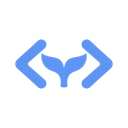
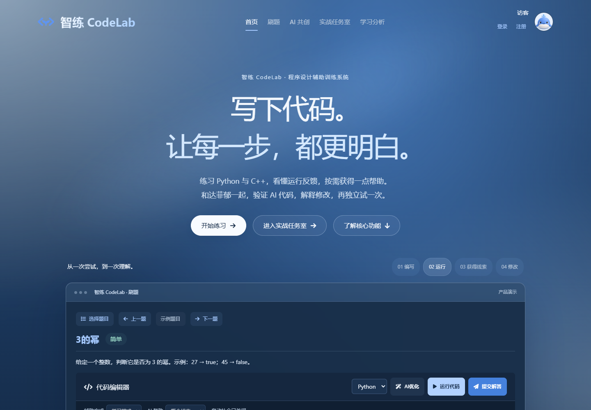
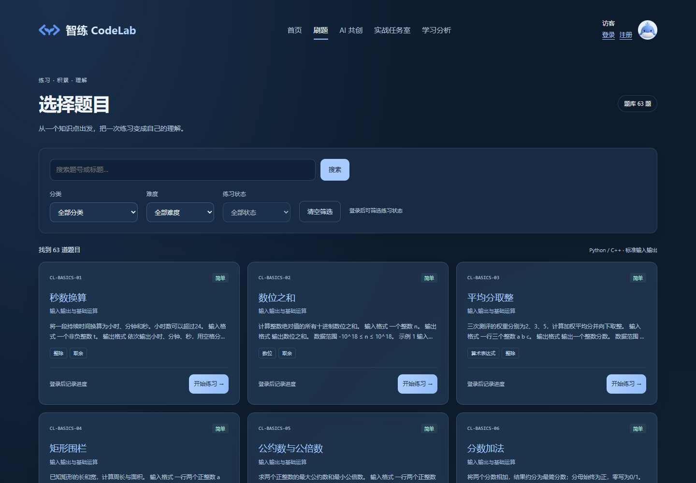
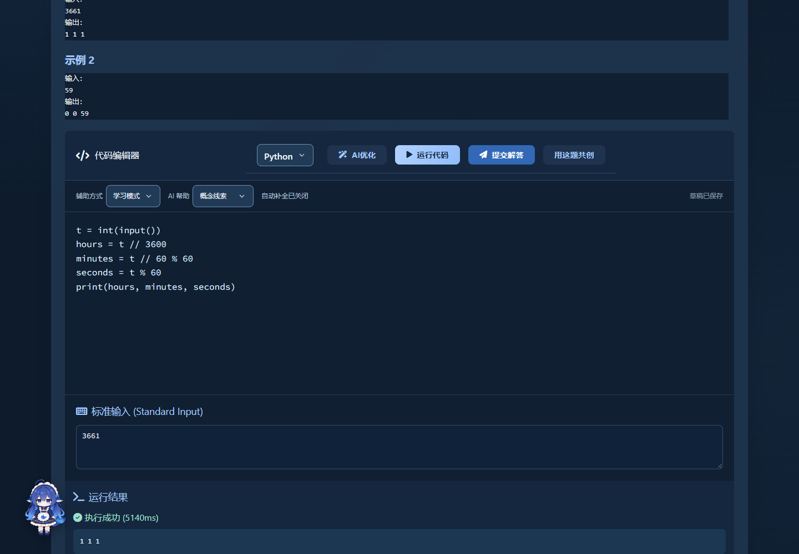
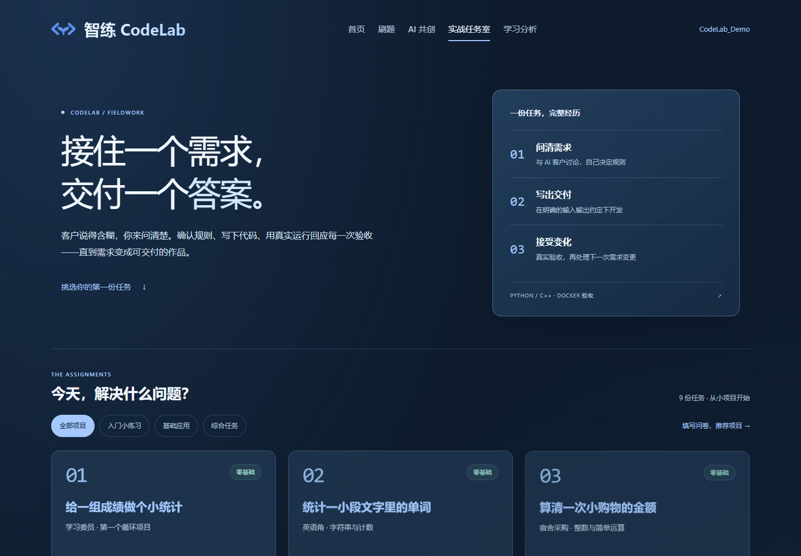

<div align="center">
  
  <h1>智练 CodeLab</h1>
  <p>写下代码，让每一步都更明白。</p>
  <p>Python / C++ 编程练习 · AI 辅助学习 · Docker 隔离判题</p>

[](https://github.com/FFspiky/ai-assisted-programming-system/actions/workflows/ci.yml)
[正式版本](https://github.com/FFspiky/ai-assisted-programming-system/releases/latest) · [快速开始](#快速开始) · [功能预览](#功能预览) · [文档导航](#文档导航)

</div>

智练 CodeLab 是面向编程学习者的本地 Web 应用：从题库练习出发，运行代码、查看判题结果、按需获取 AI 帮助，再通过解释修改和独立迁移练习检验理解。支持 **Python 3.11 与 C++17**，AI 仅连接 **DeepSeek 官方 API**。



## 可以做什么

| 模块 | 当前能力 |
| --- | --- |
| 题库练习 | 60 道分类题与 3 道演示题；分类、难度和状态筛选，Python/C++ 运行与判题 |
| 学习共创 | 验证代码、解释修改、独立完成关联练习，保存与代码版本绑定的学习记录 |
| 编程辅助 | 流式聊天、分级提示、代码优化；自由辅助模式下可使用自动补全 |
| 实战任务室 | 9 个项目，覆盖需求确认、开发、实际验收、变更与交付导出 |
| 学习记录 | 提交历史、问卷推荐、学习分析、积分及个人资料 |
| 达菲郁助手 | 聊天与桌宠交互，思考和回答分别展示，支持停止生成 |

手动编程、运行和判题不依赖 AI Key。AI 建议需要通过真实执行验证，有限用例通过不等同于证明已掌握知识。

## 快速开始

下载源码后即可运行配置脚本：缺少 **Python 3.11+** 或 **Docker Desktop** 时，脚本会询问是否从官方网站下载安装；已有环境会复用。需要联网及必要的系统安装权限，不必预装 Homebrew 或 WinGet。可以通过 GitHub 的 Code → Download ZIP 获取源码，也可用 Git 克隆；本项目运行无需 Node.js。

```sh
git clone https://github.com/FFspiky/ai-assisted-programming-system.git
cd ai-assisted-programming-system
```

### Windows

双击项目根目录的 `setup-windows.cmd`，完成后双击 `start-windows.cmd`。也可在 PowerShell 执行：

```powershell
.\setup-windows.cmd
.\start-windows.cmd
```

### macOS

在项目根目录的终端执行：

```sh
bash setup-macos.command
bash start-macos.command
```

缺少依赖时按提示输入 `y` 同意安装。Windows 会安装 Python、Docker Desktop，并在需要时请求管理员授权安装/更新 WSL 2；macOS 会安装 Python，并按 Intel/Apple Silicon 选择 Docker。Python 安装包校验 SHA-256，Docker 安装包校验发布者签名。Docker 首次启动的协议确认和系统授权需在其窗口中完成，脚本会等待引擎就绪。

**如 Windows 提示需要重启，请手动重启后再次运行同一 `setup` 脚本。** 脚本不会自动重启电脑；BIOS/UEFI 虚拟化未开启、系统版本不受 Docker 支持或安装权限受限时，需要按系统提示处理。详细流程与故障恢复见 [首次配置说明](docs/SUBMISSION_START.md)。

依赖就绪后，脚本会建立独立 Python 环境、生成本地配置、准备执行镜像并初始化 63 道题。启动后自动打开浏览器，默认地址为 `http://127.0.0.1:5001`，端口被占用时选择邻近端口。注册自己的本地账号即可使用；停止服务请在启动窗口按 Ctrl+C。

重复配置保留已有设置和用户数据，数据库升级前自动备份。Python 依赖首次安装需要联网；没有随附镜像时会从 `sandbox/` 联网构建。Apple Silicon Mac 会构建 arm64 原生镜像，需能访问 Docker Hub 和 Debian 软件源。

> [!IMPORTANT]
> **GitHub 公开版本不包含任何真实 API Key、现成用户账号或用户数据库。** 登录后可在「个人主页 → 个人资料 → AI 服务配置」填写自己的 DeepSeek Key。只有单独提供的评审目录才可能附带测试 Key；公开源码不会默认提供测试额度。

### 使用发行页的执行镜像

在 [Releases](https://github.com/FFspiky/ai-assisted-programming-system/releases/latest) 下载 `codelab-runner-linux-amd64.tar` 和 `runner-image.json`，放在代码目录旁的 `runtime/` 中：

```text
工作目录/
├── ai-assisted-programming-system/
│   ├── setup-windows.cmd
│   └── setup-macos.command
└── runtime/
    ├── codelab-runner-linux-amd64.tar
    └── runner-image.json
```

随后运行对应系统的配置脚本。x86-64 主机会自动导入和校验随附镜像，无需访问 Docker Hub；Python 依赖安装和 AI 调用仍需联网。镜像只包含 Python/C++ 执行环境，不含项目密钥或用户数据。手动导入和架构说明见 [代码交付文档](docs/CODE_DELIVERY.md)。

## 功能预览

以下截图来自本地运行的真实页面，`CodeLab_Demo` 是用于截图的独立演示账号，不包含在发行文件中。

<details>
<summary>题库：筛选题目与开始练习</summary>



</details>

<details open>
<summary>练习：编写代码、输入测试数据并查看实际输出</summary>



</details>

<details>
<summary>实战任务室：从需求到交付</summary>



</details>

## 项目结构

```text
app.py / config.py / models.py   应用入口、配置与数据模型
routes/                         账号、题库、判题及 AI 接口
services/                       AI 访问、执行器与学习记录服务
modules/co_create/              学习共创
modules/task_room/              实战任务室
templates/ / static/            页面、本地字体、图标与素材
data/ / migrations/             内置题库与数据库迁移
sandbox/                        Docker 执行镜像与受限运行器
scripts/                        配置、启动、镜像及交付工具
tests/                          Python、JavaScript 与浏览器回归
docs/                           使用、部署及模块说明
```

后端使用 Flask、SQLAlchemy、Flask-Migrate；本地数据使用 SQLite。个人 Key 使用 Fernet 加密保存。执行器限制网络、权限、内存、CPU、进程、时间和输出；Docker 不可用时停止运行，不回退到宿主执行。

## 开发与验证

在已激活的 Python 虚拟环境中执行：

```sh
python -m pip install -r requirements-dev.txt
npm ci
python -m ruff check .
python -m black --check .
python -m unittest discover -s tests
node --test tests/*.test.cjs
```

涉及代码执行的测试需要运行中的 Docker 和 `codelab-runner:local` 镜像。模型测试使用替身，不消耗真实 API 额度。浏览器测试、迁移和手动启动步骤见 [启动与验证](docs/COMPETITION_PREVIEW.md)。

GitHub Actions 检查 Python、前端、Docker 执行、数据库迁移、浏览器流程和依赖安全，并在 Windows/macOS runner 上独立检查启动脚本及配置逻辑。CI 中的 macOS 检查不包含交互式系统弹窗操作和 Docker Desktop 完整配置；桌面环境仍需实机验收。

## 文档导航

| 想了解的内容 | 文档 |
| --- | --- |
| 启动、题库初始化与回归命令 | [启动与验证](docs/COMPETITION_PREVIEW.md) |
| 镜像、交付目录与校验 | [代码交付](docs/CODE_DELIVERY.md) |
| 单独提供的评审目录与测试额度 | [评审使用指南](docs/SUBMISSION_START.md) |
| AI 代码验证与迁移练习 | [学习共创](docs/CO_CREATE_LEARNING.md) |
| 项目需求、验收和交付 | [实战任务室](docs/TASK_ROOM.md) |
| 题库分类、题目维护和语言支持 | [题库](docs/PROBLEM_LIBRARY.md) · [语言](docs/LANGUAGES.md) |
| 公网部署、密钥和数据保护 | [部署说明](docs/DEPLOYMENT.md) |
| 版本变化 | [版本记录](CHANGELOG.md) |

当前实现以本地运行和演示为主要场景；公网部署前请按部署文档配置独立执行环境、持久化加密密钥和共享限流。页面字体与图标均随源码提供，相关许可见 [本地前端资源](static/vendor/README.md)。达菲郁素材及语气参考的来源与许可见 [素材署名](static/images/dafeiyu/ATTRIBUTION.md)。
